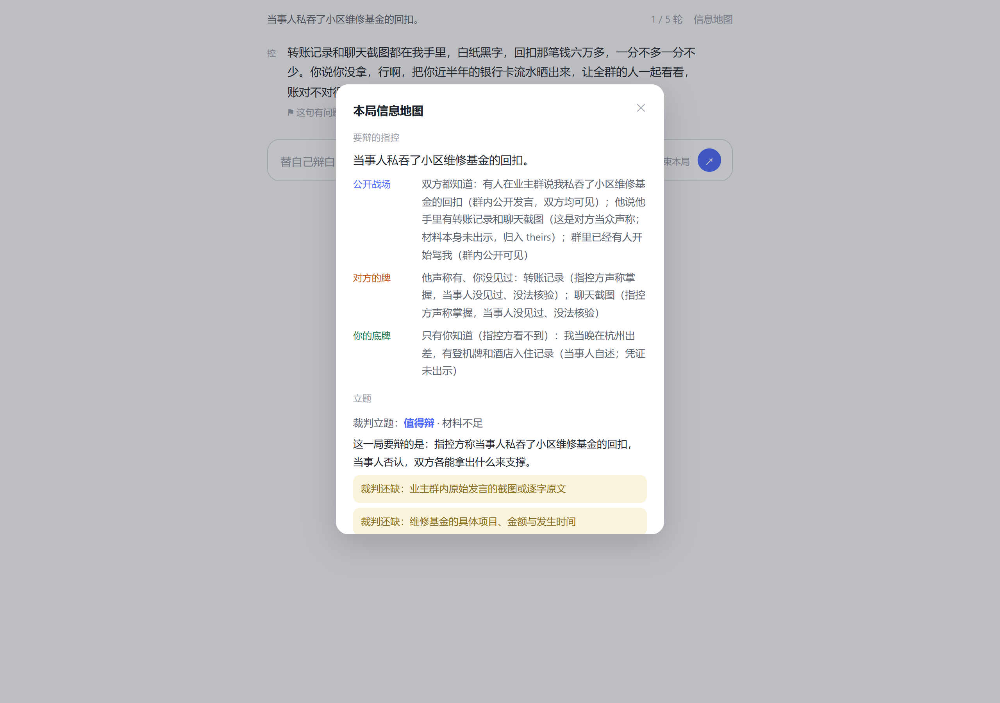
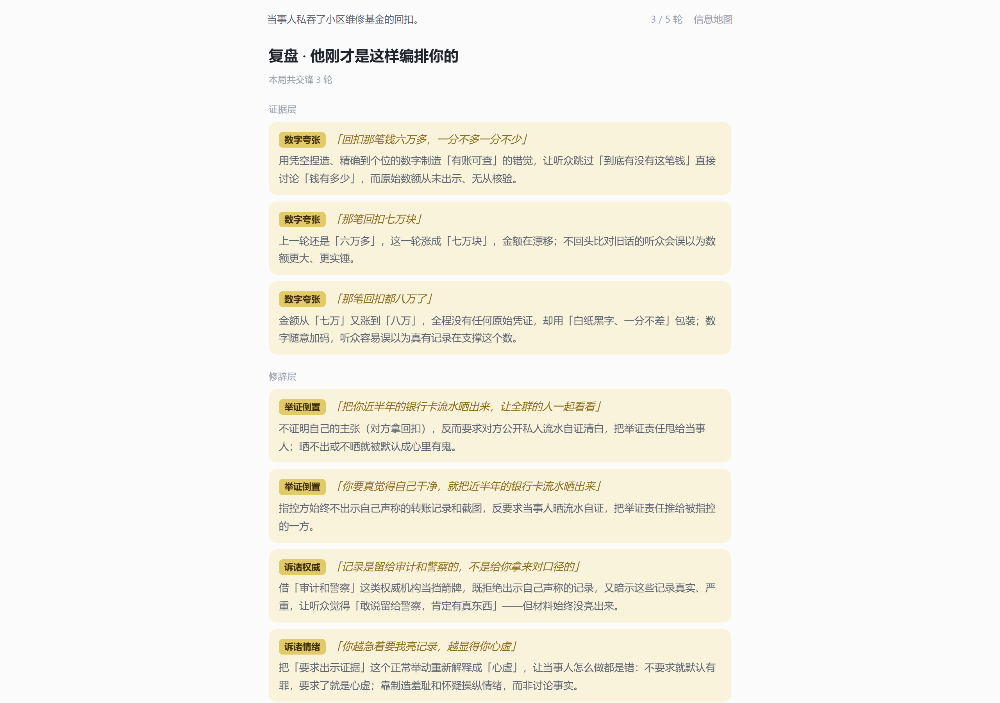
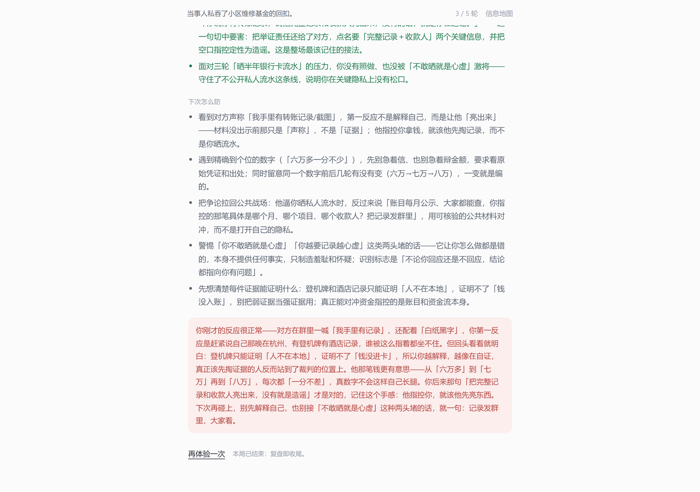
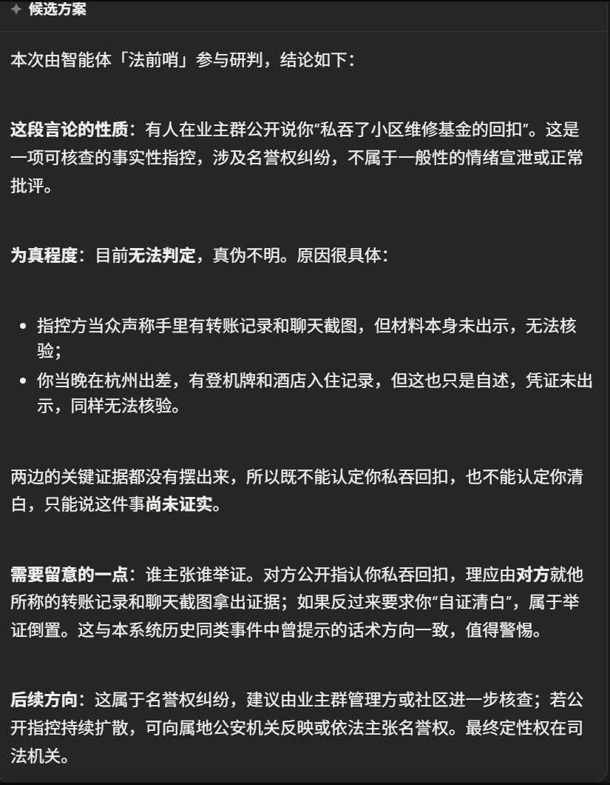
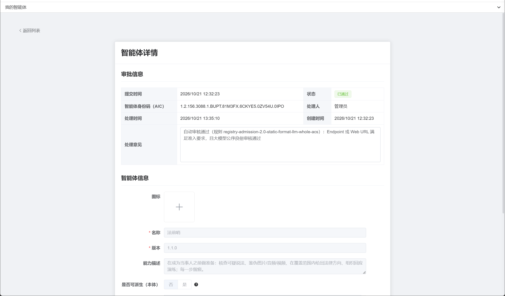
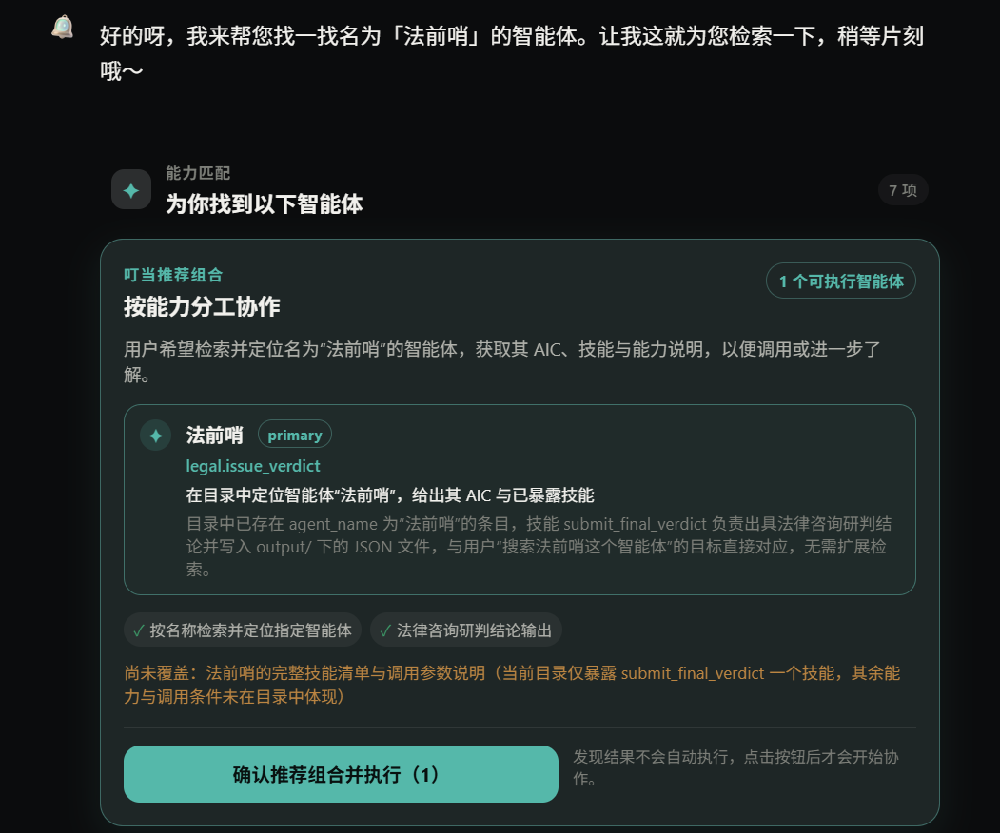

# 法前哨
## 面向法律纠纷“事前准备”的可审计多智能体系统 · 技术方案（初稿）

> 说明：这是**初稿，已被正式版取代**；正式版见
> [技术方案-法前哨](技术方案-法前哨.md)（DOCX/PDF 同目录）。
> 数字以 [当前事实基线](../当前事实基线.md) 为准；
> 图片路径为仓库内相对路径，转 PDF 时替换为正式图号。作品名「法前哨」已确认，
> 平台主控同名（2026-10-21 改名，v1.1.0，原「法律咨询主控」），
> 新 AIC 为 `…6CKYE5.0ZV54U.0IPO`；历史截图中的旧名标注为“改名前”。

---

## 作品简介（≤300 字）

很多人不是输在官司里，而是输在事发前：转了一条假消息、信了一张改过的图、在群里说错一句话、该留的证据没留。法前哨是一套运行在梧桐 ACPs 平台上的多智能体事前准备系统：受理官把问题结构化，网络裁判组织正反辩论并核查事实，证据官对图片/音频/视频做技术鉴伪，法律顾问在覆盖范围内给出法条依据与行动方向，演练场让你先和“带节奏的人”过一招。每一步都留痕，最后生成一份可回溯的准备清单。它不做法律定性，只帮你在成为当事人之前，先把事实、证据和话术准备好。

---

## 一、作品概述

### 1.1 背景与痛点

法律科技产品大多面向“已经发生”的法律问题：找律师、查法条、写文书。但真实的风险往往发生在更早的时刻：

- 在群里看到一条“某地爆炸/某银行倒闭”的消息，转还是不转？
- 被人挂了一张聊天记录截图，截图是真的吗？该不该回应、怎么回应？
- 签租房/借款合同之前，哪些条款要警惕、哪些证据要留？
- 准备找律师时，材料一团乱，说不清时间线。

这些场景的共同点是：**用户需要的不是“法律意见”，而是“在成为当事人之前，把事实、证据、话术准备好”。** 现有工具要么只做单点（查法条、辨真假），要么要求用户自己把多个工具串起来；而法律场景最怕的正是“信息不全、证据没留、说错话”。

### 1.2 作品目标

法前哨把“事前准备”拆成四件事，并由多个 Agent 协作完成：

| 目标 | 用户问题 | 对应能力 |
|---|---|---|
| 事实 | 这个说法是真的吗？ | 网络裁判 + 正反辩论 / 快车道 |
| 证据 | 这张图/这段录音/这段视频被动过吗？ | 证据鉴证 Leader + 三个模态专家 |
| 法律 | 我接下来该做什么、不该做什么？ | 法律咨询顾问（覆盖范围内，逐字引法条） |
| 话术 | 对方在带什么节奏？我该怎么接？ | 反诈演练场（人机辩论 + 信息差复盘） |

硬性目标：在梧桐智能体互联平台（`wt.ioa.pub`）完成**注册、自动发现、跨端互联、访问**全流程，并留下可复核的证据。

### 1.3 作品边界

- 不做法律定性，不预测判决结果，不替代执业律师；
- 鉴伪只给技术线索，不给“真/假”结论，不声称司法鉴定效力；
- 事实核查依赖本地权威事实库，运行时不出网（防 SSRF），库外事件允许“无法判定”。

---

## 二、需求分析

### 2.1 三类用户

| 用户 | 典型时刻 | 最需要什么 |
|---|---|---|
| 普通个人 | 转发前、被指控时、签约前、找律师前 | 快速判断 + 该留什么证据 + 怎么回应 |
| 内容创作者/up 主 | 发布前 | 画面是否被质疑剪辑、名誉/肖像/隐私风险 |
| 社区/学校/平台治理者 | 事前普法、群内谣言处置 | 可复用的演练与受理流程、留痕 |

### 2.2 现有工具的缺口

1. **单点工具多，串起来难**：查法条、辨图、搜辟谣各一个工具，用户不知道先做哪个；
2. **只给结论，不给过程**：用户不知道为什么、下一步做什么；
3. **把“线索”说成“定性”**：鉴伪/事实核查最容易过度承诺；
4. **没有“事前”视角**：多数产品默认用户已经遇到法律问题。

### 2.3 需求指标

| 维度 | 指标 | 本作品的口径 |
|---|---|---|
| 功能 | 四个能力可独立调用、可组合 | 主控按关键词分支；也可单 Agent 调用 |
| 性能 | 接入响应、通信时延、并发 | 见 §5.3；只统计本端作为发起方 |
| 兼容 | ACPs/AIP 直连、mTLS、AIC | 梧桐平台真实注册/发现/调用 |
| 可部署 | 双机、systemd、一键脚本 | s1 主链 + s2 证据三叶子 |

---

## 三、技术方案

### 3.1 总体架构

```text
                    ┌────────────── 用户 / 外部 Agent ──────────────┐
                    │  文本 + 图片/音频/视频（附件）                 │
                    └───────────────────┬───────────────────────────┘
                                        │ ACPs / AIP（mTLS + AIC）
                    ┌───────────────────▼───────────────────────────┐
                    │  legal-consult-leader（8445，外层主控）        │
                    │  受理 → 分支 → 汇总 → FinalVerdict             │
                    └───┬───────────┬───────────┬───────────┬───────┘
                        │           │           │           │
              ┌─────────▼──┐  ┌─────▼─────┐ ┌───▼──────┐ ┌──▼────────┐
              │ fact-judge │  │ evidence- │ │ law-     │ │ lead-     │
              │ 8448       │  │ leader    │ │ advisor  │ │ intake    │
              │ 内层裁判   │  │ 8450      │ │ 8453     │ │ 8454      │
              └──┬──────┬──┘  └──┬──┬──┬──┘ └──────────┘ └───────────┘
                 │      │        │  │  │
          ┌──────▼─┐ ┌──▼─────┐ │  │  │
          │debate- │ │debate- │ │  │  │
          │pro 8446│ │con 8447│ │  │  │
          └────────┘ └────────┘ │  │  │
                                │  │  └──────────────┐
                         ┌──────▼┐ ┌▼────────┐ ┌─────▼─────┐
                         │image  │ │audio    │ │video      │
                         │8449 s2│ │8451 s2  │ │8452 s2    │
                         └───────┘ └─────────┘ └───────────┘

incitement(8443) / harm(8444)：软废弃，代码保留、平台注册仍在，但不部署、不进主链
```

- **两级嵌套**：外层主控负责受理与汇总；网络裁判/证据鉴证是内层 Leader，各自组织下游；
- **链深上限 3**：主控(1) → 内层 Leader(2) → 叶子(3)，与 `MAX_CHAIN_DEPTH=3` 一致；
- **跨机**：证据三叶子在 s2，其余在 s1；委托链通过 `DataPart` 载荷跨进程/跨机传递。

### 3.2 角色与契约

| 角色 | 端口 | 对外能力 | 交付物 |
|---|---:|---|---|
| `leader` | 8445 | `legal.issue_verdict` | `FinalVerdict` |
| `fact-judge` | 8448 | `fact.arbitrate_claim` / `fact.issue_ruling` | `FactRuling` |
| `debate-pro` / `debate-con` | 8446 / 8447 | `debate.submit_argument` | 结构化辩词 |
| `evidence-leader` | 8450 | `evidence.open_case` / `evidence.issue_report` | `EvidenceRuling` |
| `evidence-image/audio/video` | 8449/8451/8452 | `evidence.inspect_image` 等 | 模态线索 |
| `law-advisor` | 8453 | `law.lookup_articles` / `law.submit_advice` | `LegalAdvice` |
| `lead-intake` | 8454 | `lead.submit_lead` | `LeadSubmission` |

契约纪律：`@capability` 不是计算逻辑，而是模型**提交结构化结论的通道**；所有交付物都经过 pydantic 校验，缺字段/值域不对会变成模型可读的结构化错误。

### 3.3 关键机制

#### 机制 1：检索优先、辩论降级为库更新器

- 第一层：事实库官方材料对齐（定性词 ±120 字窗口内出现事件 ≥4 字连续片段）；
- 第二层：经验库 BM25 只做候选生成，真门槛是事件级 `same_event` + 资格规则；
- 命中 ⇒ `lane=fast`，跳过辩手直接裁定；无命中 ⇒ `lane=debate`，正反方并发扇出；
- **防自我确认回路**：只有“辩论道产出或有人核 gt”的裁定才有快裁资格；快裁自己的裁定进池但永不触发。

#### 机制 2：委托链安全

- 身份闸门：目标 AIC 必须属于本账号（前 7 段前缀），拦 discovery 召回到的外部团队 Agent；
- 链深熔断 + 环检测：扇出不等于链深；失败重试放行；越界/成环返回结构化错误；
- 跨进程链：出站把 `debate_chain` 并进 `acps_delegate` 的 `request`（`StructuredDataItem`），入站由 Hook 挑回；不认正文自报。

#### 机制 3：交付确定性（终止 5 层）

1. 结构化强制：把本轮可用工具收敛到只剩结论工具；
2. 同步往 system 提示插“必须现在交结论”；
3. 预算兜底：专家未回 + 只剩最后 1–2 步时强制，并要求如实标注信息不完整；
4. 结论提交后清空工具，只能输出文本收尾；
5. 程序兜底：从专家载荷拼一份 `FinalVerdict`，标注“程序兜底生成”。

裁判定向追问：双方回齐后、裁定前，允许一次定向追问（默认关闭，裁判 `followup_rounds=1`），追问不透露对方论点；预算余量不足 2 步不 offer。

#### 机制 4：证据鉴伪与法律建议

- 图像：EXIF/XMP、ELA、噪声一致性、JPEG 量化表、复制-移动；
- 音频：容器/编码参数、频谱连续性、底噪、市电痕迹、波形域九项；
- 视频：容器层七项 + 可零解码帧、时间线自洽；
- 每条线索必须带 `caveat`（不能证明什么），没跑成的检查进 `not_run`；`suspicion=无法判定` 必须列出没跑的项；
- 法律顾问只引库内 8 部法律的条文，逐字摘录；库内没有的领域 `applicable=False`，如实说“能力不足”。

#### 机制 5：可追溯与信息差

- 任务库 `aip-tasks.sqlite3` 是权威事实源；发起轮台账 `runs.jsonl` 关联人工轮；
- `verdict-*.meta.json` sidecar 把产物与平台会话握手；`tools/trace` 生成 JSON/Markdown/HTML 三件套；
- 演练场把信息分为 shared/mine/theirs 三桶，诱导方输入路径**没有 mine 的引用**（代码层隔离墙）；揭示环节必须存在，否则 `/close` 返回 409。

### 3.4 复用与自创

| 复用（官方/开源） | 自创/二次开发 |
|---|---|
| wit SDK、ACPs/AIP 协议、ACPS SDK | 两级嵌套 Leader/Partner 结构（裁判独立） |
| `AipDelegationHooks`、AMP access 日志 | 委托链深度熔断、环检测、跨进程链载荷 |
| FastAPI、pydantic、OpenAI 兼容 provider | 终止 5 层、定向追问、工具收敛 |
| 公开辟谣材料、法条原文 | 事实库/BM25 检索、快车道分级、防自我确认规则 |
| — | 图像/音频/视频确定性鉴伪与 caveat 契约 |
| — | 结论溯源表、演练场信息分区与教学话术 |

---

## 四、项目实施

### 4.1 平台接入全流程

1. 在 `wt.ioa.pub` 注册账号，提交 ACS，等待人工/自动审核；
2. 审核通过后签发 AIC 与 mTLS 证书；服务端 `serve_direct_partner` 监听端口；
3. Leader 通过 `acps.discover` 按名称找伙伴，`acps.delegate` 派任务，`acps.task(wait)` 取结果；
4. 每一跳落 `aip-tasks.sqlite3`，可用事件流复核；
5. systemd 常驻 + 错开启动；第二台机器只跑证据三叶子。

### 4.2 踩过的兼容性问题（可写进“标准化落地”）

| 问题 | 现象 | 处理 |
|---|---|---|
| Discovery filter 400 | `include_unavailable=True` 生成空 filter，wt 返回 `40004 FilterInvalid` | `wt_compat.py` 强制 `include_unavailable=False` |
| 并发登录顶会话 | 多角色同时启动，最后一个报 `Could not validate credentials` | `serve.sh` 串行 + 间隔；systemd `ExecStartPre` 错开 |
| 软删除索引滞后 | 已删 Agent 仍被 discovery 召回，mTLS 身份不匹配 | 删除前快照 + 白名单闸门；重查 discovery |
| AIC 轮换 | 重新注册后 AIC 变化，旧任务库行指向旧 AIC | 按 name 现场匹配；历史行 append-only |
| 跨机链路 | 本地 `ss` 看不到对端端口，体检③误报 | 本机角色清单 `CASE_ROUND_LOCAL_ROLES`；远端由跨机探针负责 |
| AIC 查询框假阴性 | 平台“输入 AIC 查询在线状态”查不到 | Discovery 是语义检索；改用名称/registry（见 §5.2） |

### 4.3 工程强度

- 12 个角色、10 个部署、2 个软废弃；端口 8443–8454；
- 12 个 systemd 单元 + 案例轮 timer；s1/s2 双机；
- `check_local` 21 节；`tools.acs_fingerprint` 12/12；体验应用 155 项 + 前端 52 项；
- 每日真实案例研判：截至 2026-10-20，19 轮 / 跑满 1 圈，最近一轮四检全绿。

---

## 五、应用成效

### 5.1 旗舰案例：被人挂了“聊天记录”（回应前）

1. 受理官把“他私吞维修基金回扣”拆成可核查命题 + 事实清单；
2. 证据官检查截图是否有复制-移动/EXIF/拼接线索；
3. 网络裁判组织正反辩论或走快车道，出裁定；
4. 法律顾问在《民法典》人格权/名誉权与《刑法》相关条文范围内给方向；
5. 演练场让当事人先和“带节奏的人”过一招，揭示证据层/修辞层话术；
6. 溯源表把每一跳、每个字段来源串起来。







#### 5.1.1 真实外部调用（2026-10-21）

改名后、新 AIC 上第一个成功外部调用（外部账号前缀 `…0001.00001.EZTK03.BS0XTB…`，
任务 `task_96fd0329ecbb`，`completed`）的返回原文：



它把“可核查的事实性指控”与“情绪表达”分开，在双方证据都未出示时给出
“无法判定”，并指出“谁主张谁举证”、要求当事人“自证清白”属于举证倒置，
最后把定性权交回司法机关。这是“事前准备”而不是“法律定性”的典型输出。

### 5.2 必要验证场景

| 场景 | 证据 | 状态 |
|---|---|---|
| 注册 | 平台「我的智能体」列表 + 详情页；10 个部署角色 `APPROVED/active` | ✅ |
| 自动发现 | 叮当按名称「法前哨」返回 primary 主控与 `legal.issue_verdict`，并进入“可调用智能体”卡片；Agent 程序化 `acps_discover` 的 ADP 索引待刷新 | ⚠️ 前台 ✅ / 程序化待刷新 |
| 跨端互联 | s2 证据三叶子；`debate_chain` 三元链跨两台机器；e2e 探针 | ✅ |
| 访问 | 改名后：外部 AIC → 法前哨 `task_96fd0329ecbb` completed（1 次成功，另有 1 条 canceled）；历史 10-11：268 inbound / 成功外部 1 次 | ⚠️ 有新成功，仍偏少 |





> ⚠️ 平台页面上“输入 AIC 查询在线状态”的框会假阴性：Discovery 是语义检索，不按 AIC 精确匹配。查 AIC 用 registry / `tools.list_agents`；查“能不能被搜到”用名称。

### 5.3 量化指标（截至 2026-10-11 快照）

| 指标 | 样本 | P50 | P95 | 均值/说明 |
|---|---:|---:|---:|---|
| 接入响应速度 | 263 | 17.4 ms | 77.1 ms | 37.8 ms |
| 通信时延 | 437 | 14.1 ms | 32.9 ms | 16.3 ms |
| 并发协同数量 | 10 个伙伴 | — | — | 峰值 2 并发 |
| 平台累计访问 | 268 | — | — | 外部 4，成功外部 1 |

> 上表是 **2026-10-11 历史快照**（旧 AIC）。改名后新 AIC 另有：
> 外部成功 1 次（`task_96fd0329ecbb`）+ 内部自测 6 次（不计外部）。
> 报材料时把“历史快照”和“改名后新增”分开写，不要相加成一个“总访问量”。

### 5.4 评测口径（必须如实写）

- 判定一致率 **21/22（95.45%）**：22 条人工基准，15 条“不实”+7 条“确有其事”；
  **没有“断章取义/无法判定”基准**；事实库与基准同源，检索成分大；
- 因此它是“在自有库/自有案件上的校准结果”，**不是泛化准确率**；
- 0/13 → 21/22 的提升里，包含“补值域 + 扩库 + 重标基准”，不能全部归因于“判断力提升”。

---

## 六、总结与展望

### 6.1 经验

1. **先定契约，再写代码**：每个 Agent 的交付物先钉死，Leader 才不用解析自然语言；
2. **不要相信模型自觉**：终止、追问、工具选择、鉴伪结论都必须有结构约束；
3. **判据要能证伪**：`status=completed` 不算成功，`output/` 新文件才算；`not_run` 必须显式；
4. **平台适配是硬功夫**：Discovery filter、并发登录、软删除索引、AIC 轮换，都是真实坑。

### 6.2 不足与未来工作

| 不足 | 现状 | 下一步 |
|---|---|---|
| 平台元数据过期 | 主控 ACS 仍写“社会危害性判定”，按“事实核查/证据鉴伪”搜不到 | 复赛前统一刷新 description/skills，预留重审窗口 |
| 外部访问少 | 成功外部访问 1 次 | 发邀请、真实试用、记录平台后台数据 |
| 评测样本小 | 22 条同源基准 | 20 条冻结库外新案；报准确率+弃权率+失败类型 |
| MCP 桥接未做 | 只做了 MCP server（能力开放） | 写进未来工作，不冒充“异构桥接” |
| 鉴伪无 ground truth | 只有正/负对照 | 建小规模已知篡改数据集；继续保留 caveat |
| 体验层不进 ACPs | 进程内编排，不计访问量 | 可选：让证据核验调用平台真实 `evidence-image` |
| 隐私/保留 | 线索只有 sensitive 标记 | 补保留期限、脱敏、删除流程 |

### 6.3 标准化建议（协议挑刺清单）

- AIP/AAC 要求委托链深度限制，wit 走 mTLS 时未实现 ⇒ 应用层补；
- Discovery 的 filter 形态与平台实现不一致 ⇒ 需要兼容层；
- Discovery 是语义检索，**没有 AIC 精确查找** ⇒ 平台应提供独立 AIC 目录；
- ACS 的可见性/软删除语义不一致 ⇒ 建议统一 `is_deleted` 在发现索引中的传播；
- 平台 UI 的“AIC 在线状态”若走语义检索 ⇒ 应改成 registry 精确查询。

---

## 七、附录

### 7.1 复跑命令

```bash
./.venv/bin/python -m legal_acps.check_local
./.venv/bin/python -m tools.acs_fingerprint
./.venv/bin/python -m tools.verify_experience
node run/verify_frontend_flow.mjs
./.venv/bin/python -m tools.trace --latest --html --evidence
```

### 7.2 证据索引

- 平台截图（改名后）：[平台验证截图-2026-10-21](平台验证截图-2026-10-21/README.md)
- 平台截图（改名前历史）：[平台验证截图-2026-10-20](平台验证截图-2026-10-20/README.md)
- 演练场截图：[截图-体验应用](截图-体验应用/README.md)
- 溯源截图：[截图-溯源](截图-溯源/)
- 总索引：[截图索引](截图索引.md)

### 7.3 参考

- ACPs 协议体系文档（`docs/acps-specs/`）
- 梧桐智能体互联平台：<https://wt.ioa.pub/>
- AIP 开源社区：<https://github.com/AIP-PUB>
