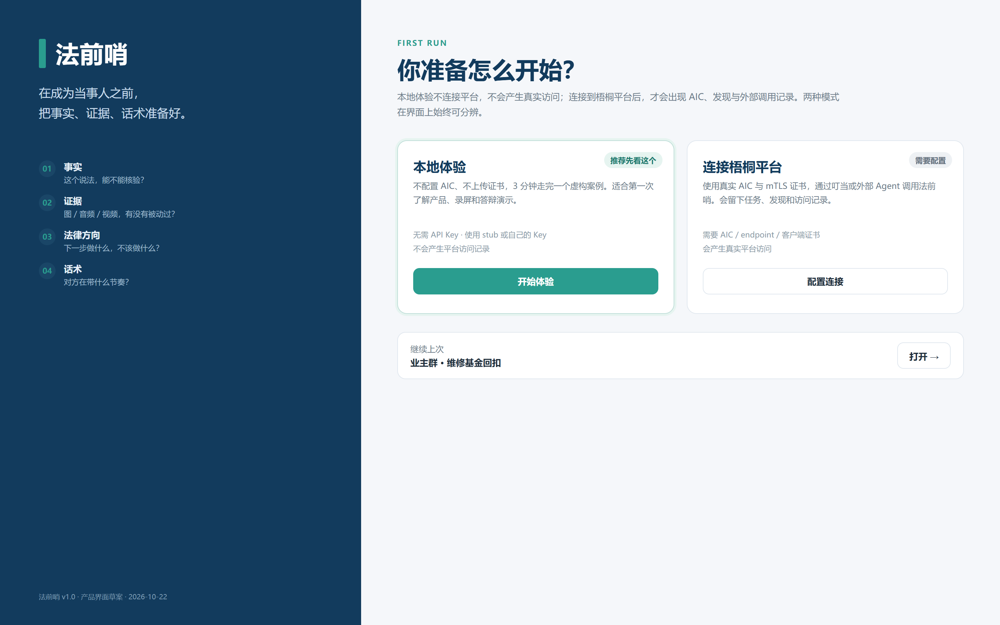
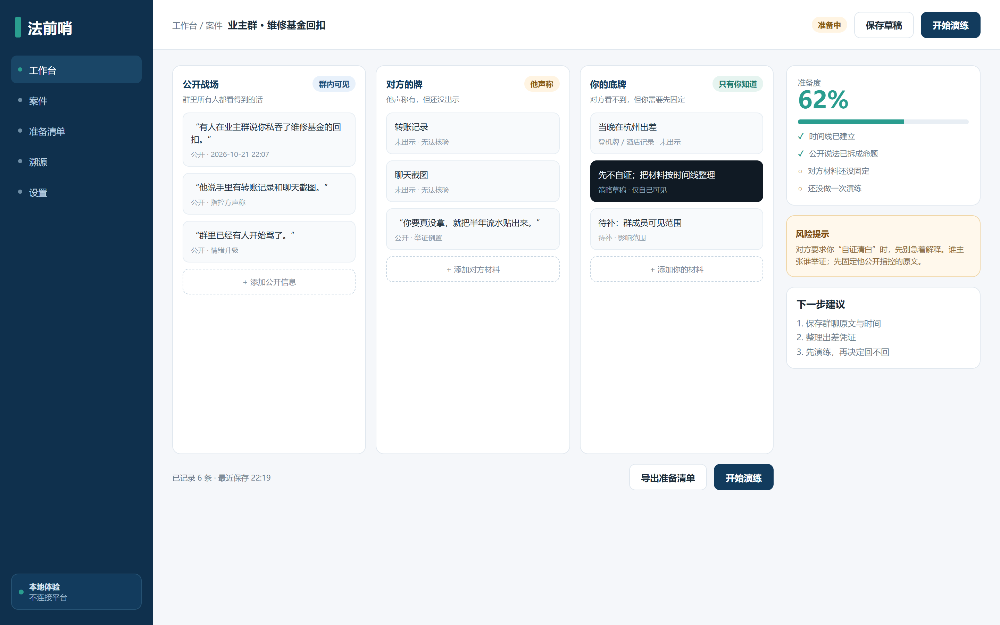
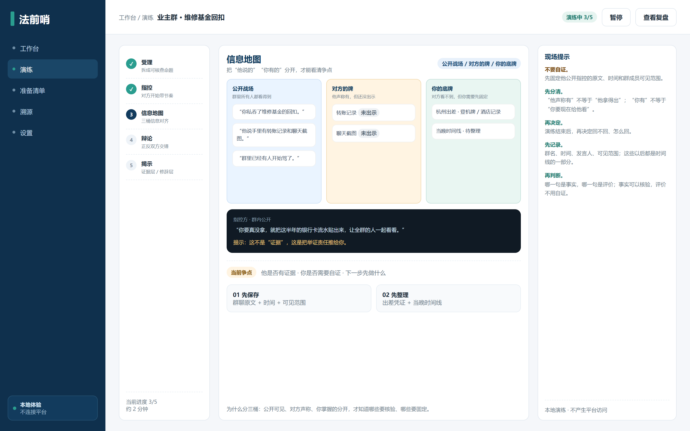
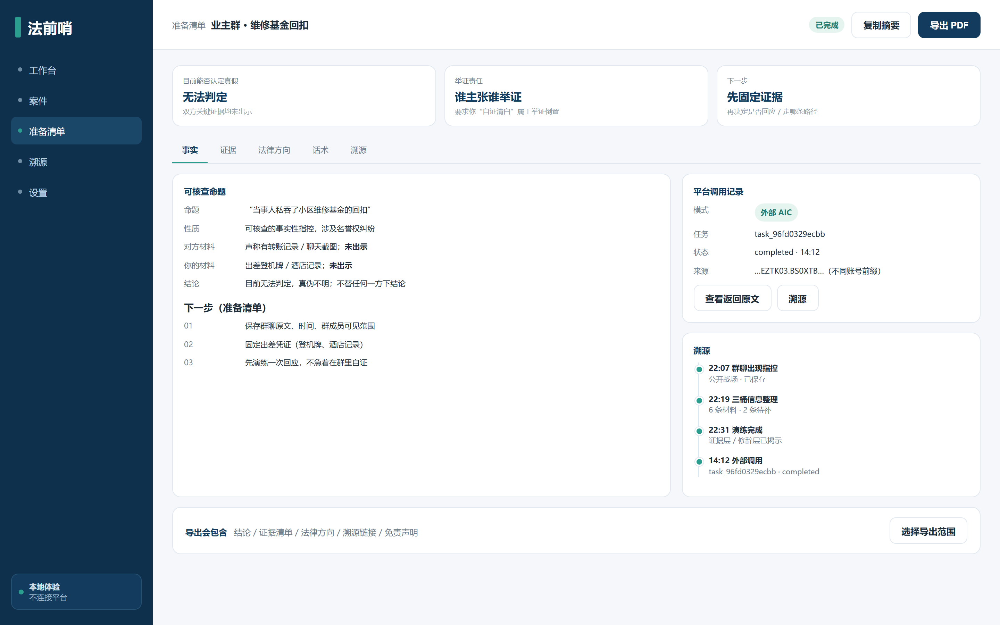
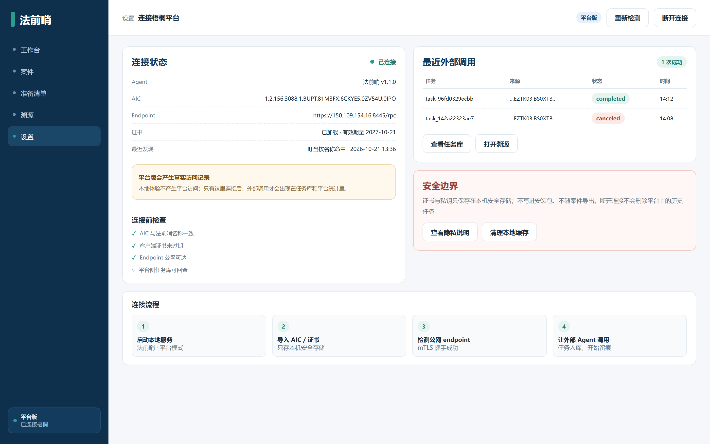

# 法前哨 · 产品形态与界面设计

> 状态：方案设计，不写代码  
> 日期：2026-10-22  
> 目标：让“法前哨”从一套可运行的多智能体工程，变成**评委敢点、普通用户敢用、自己好维护**的产品  
> 前提：初赛材料优先；本方案只做设计与边界，不改变现有 `legal_acps/` 核心
>
> ⚠️ **v2 修订（2026-10-22）**：v1 的“对方的牌”是上帝视角；真实情况是
> **声称 ≠ 手牌，手牌 ≠ 已打出**，且对方可能有从未说过的隐藏牌。  
> 主交互改为手机端。请以 [隐藏牌与手机端设计](隐藏牌与手机端设计.md) 为准；
> 本文的桌面稿保留为 v1 视觉参考，信息模型按 v2 修订。

---

## 一、结论先说

**不要做“整个项目一个 exe”。**

法前哨有三个完全不同的使用面：

| 使用面 | 用户 | 最合适的形态 |
|---|---|---|
| **体验** | 评委、普通用户、录屏 | 本地体验版（便携包/桌面 app）或托管网页 |
| **真实系统** | 外部 Agent、平台、自己部署 | 服务器 + Docker/一键部署，不是 exe |
| **演示** | 答辩现场、视频 | 体验版 + 真实平台录屏 + 准备好的案例 |

所以产品形态应该是：

> **一个体验入口 + 一个服务端部署包 + 平台/叮当入口。**

而不是一个 200MB 的 exe 里塞 12 个常驻 Agent、证书和公网 endpoint。

---

## 二、方案对比

### 2.1 桌面体验版

| 方案 | 体量 | 体验 | 跨平台 | 安全/维护 | 赛前成本 |
|---|---|---|---|---|---|
| 便携文件夹 + 启动脚本 | 小 | 中（像工具，不像 app） |  Win/mac/Linux 各一份 | 中 | ★ 最低 |
| PyInstaller + pywebview | 150–300MB | 好（双击开窗，Windows 演示） | 主要 Windows | 杀软误报、启动慢 | ★★ |
| Tauri + Python sidecar | 20–50MB + runtime | 最好（赛后产品化） | Win/mac/Linux | 需签名/构建链 | ★★★★ |
| Electron + sidecar | 150MB+ | 好（不推荐） | 三平台 | 重、维护成本高 | ★★★ |

**建议：**

- **赛前**：便携文件夹 + 一键启动，或 PyInstaller `onedir`（不要 `onefile`，启动更稳）；
- **赛后**：Tauri 壳 + Python sidecar，做签名安装包。

### 2.2 服务端

| 方案 | 适合 | 不适合 |
|---|---|---|
| Docker Compose | 真实多角色、双机、可复现 | 普通用户桌面 |
| systemd + install.sh | 已有 s1/s2 部署 | Windows 评委 |
| 单 exe | 本地演示 | 公网发现、证书、跨机 |

**建议：Docker Compose 作为“一键部署”主路径**，保留现有 systemd 作为生产部署。  
这比 exe 更符合赛题“平台接入/发现/互联/访问”的验证要求。

### 2.3 托管网页 / PWA

| 优点 | 缺点 |
|---|---|
| 零安装、跨平台、更新即时 | 需要服务器/域名/HTTPS |
| 最适合“发个链接就能试” | 真实平台调用仍需后端 |
| 可做 PWA 安装 | 隐私/数据合规要写清 |

**建议：** 如果只做一个面向大众的入口，**托管网页优先于 exe**。  
exe 是“离线演示/桌面感”的补充，不是主入口。

### 2.4 一句话对比

| 目标 | 选什么 |
|---|---|
| 评委双击就能看 | 便携包 / PyInstaller 体验版 |
| 普通用户长期使用 | 托管 Web / PWA |
| 真实多智能体运行 | Docker Compose / systemd |
| 外部门户 | 梧桐平台 + 叮当 |

---

## 三、推荐产品结构

```text
                     ┌────────────────────────────┐
                     │  体验入口（本地/托管）       │
                     │  案卷工作台 + 演练 + 准备清单 │
                     └─────────────┬──────────────┘
                                   │ 可选：平台模式
                     ┌─────────────▼──────────────┐
                     │  法前哨服务端（s1/s2）       │
                     │  ACPs 角色 + 任务库 + 证书   │
                     └─────────────┬──────────────┘
                                   │ ACPs/AIP
                     ┌─────────────▼──────────────┐
                     │  梧桐平台 / 叮当 / 外部 AIC  │
                     └────────────────────────────┘
```

三条边界：

1. **本地体验**：不注册、不加载证书、不产生平台访问；
2. **平台模式**：必须显式连接，显示 AIC/endpoint，产生真实任务；
3. **服务端**：只负责真实角色与任务库，不把证书打进桌面包。

---

## 四、目录结构设计

### 4.1 赛前：只加不动的目录

```text
witrelate/
├─ legal_acps/                 # 现有核心：赛前不改结构
│  ├─ experience/              # 现有 FastAPI + web，体验版复用
│  ├─ agents.py                # 已过审 ACS 的构建器，冻结
│  └─ ...
├─ docs/
│  └─ product/
│     ├─ 产品形态与界面设计.md   # 本文
│     └─ 界面设计/
│        ├─ prototype.html     # 可点的静态原型
│        ├─ 01-screen.png ... 05-screen.png
│        └─ README.md
├─ tools/                      # 现有运维工具
└─ ...
```

赛前**不移动** `legal_acps/`、`run/`、`tools/`，避免破坏已过审身份和自检。

### 4.2 赛后：新增产品化目录

```text
witrelate/
├─ legal_acps/                 # 保持不变，作为“引擎”
├─ apps/
│  ├─ desktop/                 # 桌面壳（Tauri / PyInstaller）
│  │  ├─ shell/                # 窗口、菜单、更新、日志
│  │  ├─ runtime/              # 启动本地 experience server
│  │  ├─ assets/               # 图标、示例案件、字体
│  │  └─ build/                # 打包脚本、签名、安装器
│  ├─ web/                     # 托管版入口（复用同一前端）
│  └─ server/                  # Docker Compose / systemd
├─ packages/
│  ├─ ui/                      # 设计 tokens + 组件（可选）
│  └─ contracts/               # 前后端 schema（可选）
└─ docs/product/
```

**原则：**

- `legal_acps/` 是引擎，`apps/` 是壳；壳不复制引擎；
- 桌面壳只调用 `legal_acps.experience.server` 的本地端口；
- 平台模式不把证书交给壳，壳只传“配置引用”；
- 体验版与平台版共用一套 UI，不维护两个前端。

### 4.3 体验版安装包目录

```text
法前哨-体验版/
├─ 法前哨.exe                 # 或 FQX-Experience.exe（ASCII 别名，防路径问题）
├─ runtime/                   # Python sidecar / 依赖
├─ data/
│  ├─ cases/                  # 虚构案例
│  └─ samples/                # 不含真实个人信息
├─ config/
│  └─ settings.example.json   # 不含 key / 证书
├─ logs/                      # 运行日志
└─ README.txt                 # 双击、离线、隐私说明
```

> 不建议 `onefile`：启动慢、杀软误报高、排障困难。  
> 不建议把 `.env`、`.wit/`、证书、API Key 放进安装包。

### 4.4 服务端部署目录

```text
deploy/product/
├─ docker-compose.yml
├─ .env.example               # 只有占位符
├─ certs/                     # 挂载，gitignored
├─ config/
├─ healthcheck/
└─ README.md                  # 一键部署、双机、回滚
```

---

## 五、界面设计

### 5.1 设计原则

1. **案卷工作台，不是聊天框**  
   不用“对话框 + 气泡”做主页；用案卷、三桶信息、准备清单、时间线。

2. **本地/平台必须一眼分清**  
   左下角常驻模式徽标：`本地体验` / `平台版`；平台版才有 AIC、endpoint、访问记录。

3. **三桶信息是主视觉**  
   `公开战场 / 对方的牌 / 你的底牌` 是产品的“思考方式”，不是普通表单。

4. **结论要克制**  
   “无法判定”用中性色，不用红色失败态；把“谁主张谁举证”做成结论卡。

5. **能导出才算完成**  
   准备清单支持 PDF/Markdown/JSON；导出内容带免责声明与溯源链接。

6. **不用颜色做唯一信息**  
   状态同时有文字/图标；色盲可读。

### 5.2 信息架构

```text
首次启动
  ├─ 本地体验（推荐）
  └─ 连接梧桐平台（需配置）

工作台
  ├─ 案件列表 / 新建
  ├─ 三桶信息
  ├─ 准备度 + 风险提示
  └─ 开始演练

演练
  ├─ 受理 → 指控 → 信息地图 → 辩论 → 揭示
  └─ 本地演练不产生平台访问

准备清单
  ├─ 事实 / 证据 / 法律方向 / 话术 / 溯源
  ├─ 平台调用记录（平台版）
  └─ 导出 PDF / Markdown / JSON

设置
  ├─ 本地/平台模式
  ├─ AIC / endpoint / 证书
  ├─ 隐私与缓存
  └─ 关于
```

### 5.3 五个关键界面

#### ① 首次启动：先选模式



要点：

- 左边用四句话讲清“事实/证据/法律方向/话术”；
- 右边两张卡：**本地体验**（推荐）与**连接梧桐平台**；
- 明确写“本地体验不产生平台访问”；
- “继续上次”只放一个案件，不堆列表。

#### ② 工作台：三桶信息



要点：

- 三列不是普通表单，而是“公开战场 / 对方的牌 / 你的底牌”；
- 右侧准备度、风险提示、下一步建议；
- 顶部只保留“保存草稿”，主行动在底部“开始演练”；
- 左下角常驻“本地体验”。

#### ③ 演练：信息地图与现场提示



要点：

- 左侧五步进度：受理 → 指控 → 信息地图 → 辩论 → 揭示；
- 中间三色泳道；深色聊天面板只放“对方原话”；
- 右侧“不要自证 / 先分清 / 再决定”；
- 底部“本地演练 · 不产生平台访问”。

#### ④ 准备清单：结论、证据、溯源



要点：

- 顶部三张结论卡：无法判定 / 谁主张谁举证 / 先固定证据；
- 下方是“可核查命题 + 下一步”；
- 右侧平台调用记录 + 时间线；
- 底部“导出会包含”明确范围。

#### ⑤ 平台连接：真实身份与安全边界



要点：

- AIC、endpoint、证书、最近发现；
- 最近外部调用表（completed / canceled）；
- 安全边界：证书只在本机安全存储，不写进安装包；
- 四步连接流程，避免用户不知道下一步。

### 5.4 关键状态

| 状态 | 界面 | 文案 |
|---|---|---|
| 本地空态 | 三桶空 + 示例案件 | “先放一条你看到的说法” |
| 本地运行 | 五步进度 + 可暂停 | “本地演练，不会上传” |
| 等待输入 | 黄色提示条 + 输入框 | “还缺一段正文；补上即可继续” |
| 平台未连接 | 灰色模式徽标 + 配置按钮 | “本地体验；连接后才能产生访问记录” |
| 平台已连接 | 蓝色徽标 + AIC | “平台版；外部调用会入库” |
| 外部调用成功 | 绿色 completed + 任务号 | “外部 AIC 调用成功” |
| 外部调用取消 | 灰色 canceled | “不计成功，保留记录” |
| 导出 | 底部抽屉 | “导出准备清单，不导出证书” |

### 5.5 视觉系统

| 项 | 值 |
|---|---|
| 主色 | 深海军蓝 `#123B5D` |
| 辅助色 | 蓝 `#1F4E79`、青 `#2A9D8F` |
| 提醒色 | 橙 `#E9A23B`；危险 `#C05A4A` |
| 背景 | 米白 `#F5F7FA`；卡片 `#FFFFFF` |
| 字体 | 思源黑体 / 微软雅黑；正文 13–14px，标题 28–32px |
| 圆角 | 10–14px；卡片细边框 1px |
| 图标 | 线性图标；状态同时有文字 |
| 图表 | 只用任务数/轮次/完成度；不堆装饰性图表 |

**视觉隐喻：**

- 夜聊是深色；产品工作台是米白——从“慌乱”到“把灯打开”；
- 青色只表示“可核验/已完成”；橙色只表示“待补/边界”；
- 不用红色大面积表示“无法判定”，避免把诚实做成失败。

### 5.6 可访问性

- 键盘可达：Tab 顺序、Enter 提交、Esc 关闭；
- 对比度：正文 ≥ 4.5:1；状态不只靠颜色；
- 字号可调：设置里 100%/115%/130%；
- 动效：尊重 `prefers-reduced-motion`；
- 导出：PDF 带文字层，不只截图。

---

## 六、技术边界与安全

| 项 | 规则 |
|---|---|
| API Key | 不内置；本地体验默认 stub；用户自己的 Key 存 OS keychain |
| 证书/私钥 | 不进安装包；平台模式由用户导入，存 OS keychain/受限目录 |
| `.wit/` | 不打包；不进案件导出 |
| 平台 endpoint | 不写死；配置项 + 连通性检测 |
| 本地数据 | 案件默认本地；提供“清空缓存/删除案件” |
| 外部访问 | 平台模式明确提示“会产生真实访问记录” |
| 日志 | 不记录正文全文；只记任务号、状态、耗时 |
| 更新 | 桌面版签名 + 手动检查更新；不静默升级 |
| 前端 | 不加载远程脚本；不用 CDN 依赖 |

---

## 七、路线图

| 阶段 | 时间 | 交付 | 验收 |
|---|---|---|---|
| **P0 设计** | 现在 | 本文 + 5 张界面图 + 静态原型 | 评审能看懂三种形态与边界 |
| **P1 便携体验** | 初赛材料交完后 | 便携包/启动器（可先不签名） | 双击能开，stub 3 分钟走完 |
| **P2 服务端** | +1 周 | Docker Compose + README | 新机器 `docker compose up` 能起 |
| **P3 桌面 app** | +2–4 周 | Tauri/PyInstaller 安装包、签名 | 无杀软误报，能导出报告 |
| **P4 托管版** | 可选 | Web/PWA 部署 | 链接可打开，隐私说明完整 |

---

## 八、验收标准

**体验版：**

- 双击后 5 秒内出现窗口；
- 不填任何 Key 也能走完一个虚构案例；
- 三桶信息、演练、准备清单、导出四步完整；
- 不出现“连接平台”的假状态；
- 卸载/清空缓存能删除本地案件。

**平台版：**

- 明确显示 AIC/endpoint/证书状态；
- 连接失败有可读错误，不是堆栈；
- 外部调用成功/取消都能在任务表看到；
- 不把证书写进日志/导出。

**服务端：**

- 一条命令起服务；
- 健康检查通过；
- 证书挂载而非写死；
- 回滚步骤写清楚。

---

## 九、不要做的事

- 不要用一个 exe 装下 12 个常驻 Agent、证书和公网 endpoint；
- 不要把 `.env`、API Key、`.wit/` 证书打进安装包；
- 不要让“本地体验”看起来像“平台已连接”；
- 不要用真实聊天记录/个人信息做界面演示；
- 不要为了桌面感重写一套前端；复用现有体验应用；
- 不要在赛前移动 `legal_acps/` 结构、改已过审 ACS；
- 不要用“AI 判案/一键胜诉”做产品文案。

---

## 十、一句话总结

**产品化的正确方向，不是“把项目塞进一个 exe”，而是：**

> **让体验有一个轻入口，让真实系统有一个稳部署，让平台身份有一条清晰边界。**
