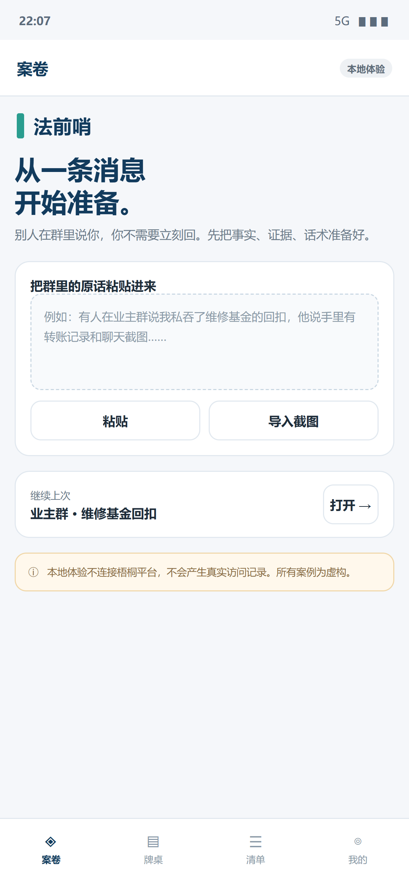
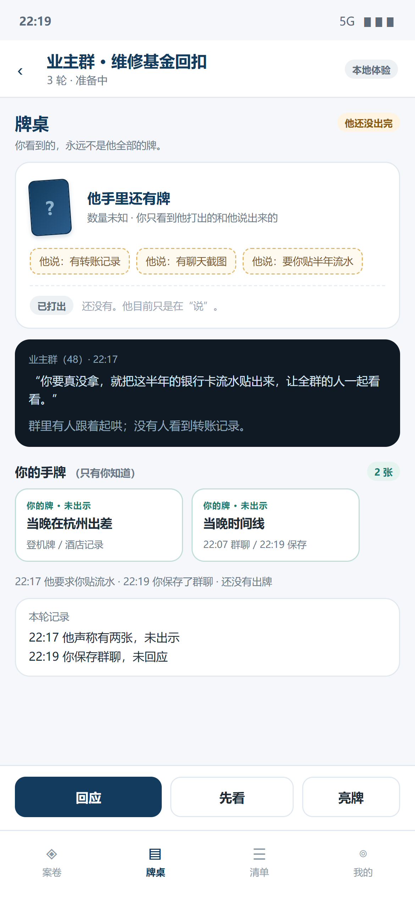
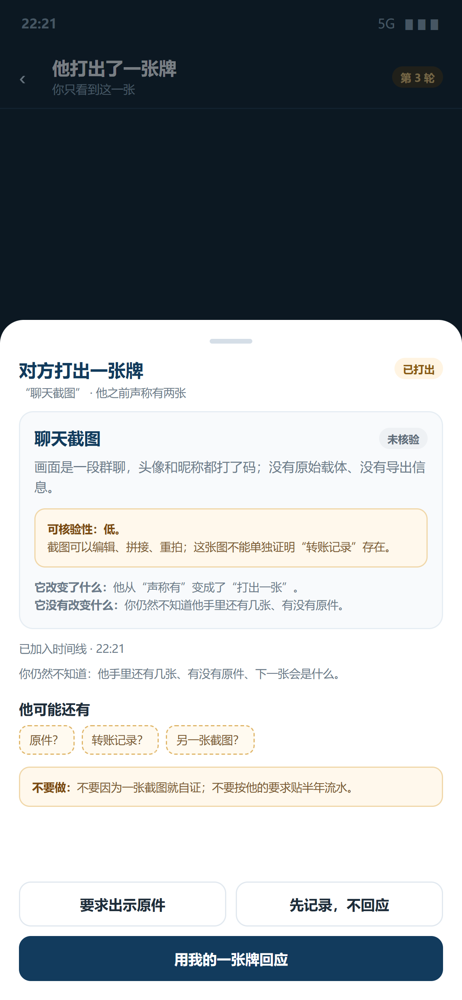
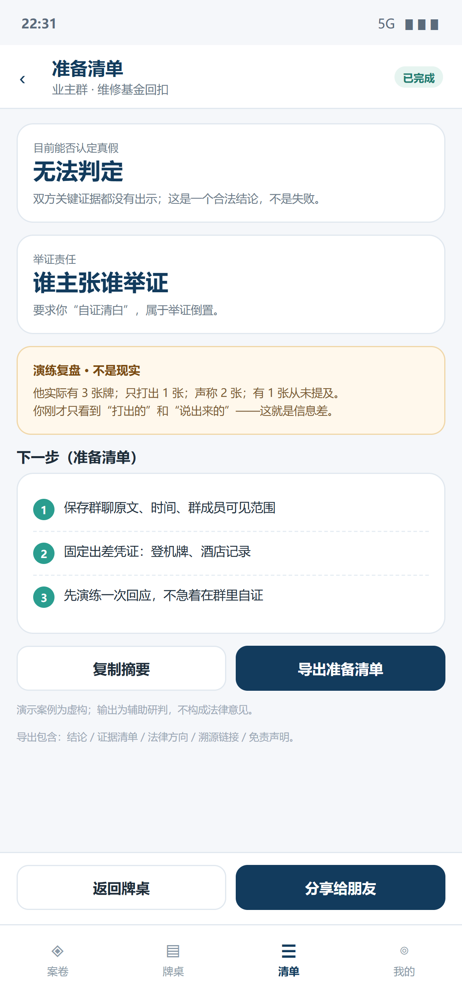

# 法前哨 · 隐藏牌与手机端设计（v2）

> 这是对 v1《产品形态与界面设计》的修订，不推翻视觉，只改两件事：  
> **对方的手牌必须是隐藏信息；主入口从桌面改成手机。**  
> 日期：2026-10-22 · 状态：设计，不写代码

---

## 一、先承认问题：v1 的“三桶”有上帝视角

v1 的工作台把对方的信息写成：

```text
公开战场 | 对方的牌 | 你的底牌
```

这看起来清楚，但有一个致命问题：**“对方的牌”被当成了已知列表**。

真实情况是：

- 他**声称有**转账记录，不代表他真的有；
- 他**真的有**转账记录，不代表他会现在拿出来；
- 他手里可能还有**从没说过**的牌；
- 他打出的那张，可能是真的，也可能是编辑过的、断章的、只对他有利的；
- 你只有在他**打出**某一张时，才看到那一张。

如果界面把他“有什么”全部列出来，用户就变成了上帝。  
**法前哨要训练的，恰恰是“在看不到对方全部牌的时候，怎么准备”。**

---

## 二、新的信息模型：五个区 + 一条真相通道

| 区 | 用户看得到什么 | 引擎知道什么 | UI 规则 |
|---|---|---|---|
| **公开战场** | 群里公开的消息、时间、谁可见 | 全部公开事件 | 可回看、可保存 |
| **他的声称** | “他说有转账记录 / 聊天截图 / 要你贴流水” | 这句话是真是假、是否对应某张牌 | **只是话，不是牌**；用虚线标签，不用牌面 |
| **他已打出** | 他实际打出的那一张（或几张） | 牌面、真伪、是否编辑、证据强度 | 打出才显示；每张都带核验结果 |
| **他没打出** | 只有一个“还有牌”的牌背 + “数量未知” | 实际手牌、数量、真假、是否 bluff | **不显示数量、不显示内容**；不要用 3 张牌背暗示 3 张 |
| **你的手牌** | 你自己的材料/话术/证据 | 你选择打出哪张 | 只有你知道；你可以选择不出 |
| **判断（belief）** | “他可能还有：原件？转账记录？另一张截图？” | 概率/候选，不是真相 | 用“可能/不确定”，不用“实际有” |
| **真相（truth）** | **游戏中不可见**；演练结束才复盘 | 完整手牌与真假 | 仅用于评分/复盘，不进入主界面 |

### 关键区分

```text
声称（claim）     ≠ 手牌（card）
手牌（card）       ≠ 已打出（played）
已打出（played）   ≠ 真实（authentic）
真实（authentic）  ≠ 能证明（probative）
```

一张“真的聊天截图”也可能只能证明“有人说”，不能证明“钱转了”。  
所以证据官给的永远是：**这张牌能证明什么、不能证明什么**，不是“真/假”两个字。

---

## 三、对方可以怎么“不老实”

| 行为 | 例子 | 用户看到 | 引擎知道 |
|---|---|---|---|
| **虚张声势** | 声称有转账记录，其实没有 | 一条“他说有”的声称 | 手牌里没有这张 |
| **藏牌** | 真有原件，但从不提 | 什么也看不到 | 手牌里有，未打出 |
| **夸大** | 只有一张模糊截图，说“转账记录+聊天截图都有” | 两条声称 | 只有一张弱牌 |
| **缩小** | 有完整流水，只说“有点记录” | 一条轻描淡写的声称 | 手牌里有强牌 |
| **打假牌** | 打出编辑过的截图 | 一张“已打出”的牌 | 鉴伪结果：疑似编辑/无法核验 |
| **挤牙膏** | 先打一张，等你回应，再打下一张 | 一次只看到一张 | 手里还有 2 张 |
| **逼你自证** | “你要没拿，就把流水贴出来” | 一句公开施压 | 他不一定有任何牌，只是在转移举证责任 |

> 这些行为不需要每次都出现；但引擎必须**允许**它们出现。  
> 否则演练就退化成“把已知材料排个版”。

---

## 四、回合怎么走

```text
         ┌────────────── 对方回合 ──────────────┐
         │ 声称 / 打出 / 施压 / 等待 / 沉默      │
         └───────────────┬──────────────────────┘
                         ↓
         ┌────────────── 用户回合 ──────────────┐
         │ 回应 / 追问 / 亮牌 / 先记录 / 不出    │
         └───────────────┬──────────────────────┘
                         ↓
         ┌──────────── 证据核验 ────────────────┐
         │ 这张牌：可核验性 / 能证明什么 / 不能   │
         └───────────────┬──────────────────────┘
                         ↓
         ┌──────────── 判断更新 ────────────────┐
         │ 他可能还有？你被骗了几次？你亮了几张？ │
         └───────────────┬──────────────────────┘
                         ↓
                    下一轮 / 结束
```

### 结束后的复盘（只有这时才给真相）

- 他实际有几张牌；
- 其中几张从没说过；
- 他声称的几张里，几张是真的；
- 他打出的牌里，几张是编辑/断章；
- 你亮了几张自己的牌，哪张其实不必亮；
- 你有没有被“逼自证”带走。

> 复盘可以给“上帝视角”，但必须明确标注：  
> **“演练复盘，不是现实。”**  
> 主界面永远不给。

---

## 五、为什么手机优先

用户原话很准：**这类事情一般是在手机上看到的，不是在笔记本上。**

手机端的优势不是“屏幕小”，而是：

- 消息在手机上；
- 截图在相册里；
- 录音在手机里；
- 你回不回、怎么回，也是在手机上；
- 事件发生时，你不可能先打开笔记本。

所以主入口应该是：

> **手机上的一个“从这条消息开始”的入口。**
> 桌面端退到“深读、整理、导出”的第二现场。

### 形态对比

| 形态 | 优点 | 缺点 | 建议 |
|---|---|---|---|
| **PWA / 手机 Web** | 零安装、跨平台、分享链接、迭代快 | 分享/相机/本地存储能力有限 | **先做这个** |
| **Capacitor / Tauri Mobile** | 能拿分享面板、相机、安全存储；一套 Web UI | 打包/签名/商店成本 | 第二步 |
| **原生 App** | 体验最好 | 双端成本高，赛前不现实 | 暂不做 |
| **微信小程序** | 传播方便 | 审核/能力/平台限制 | 可选，不优先 |

**建议：**

- 赛前/初赛材料：**手机 Web/PWA**，一个链接就能打开；
- 赛后：用 Capacitor/Tauri Mobile 包一层，拿系统分享面板和安全存储；
- 桌面端保留，但只做“深读/导出”，不再是主入口。

---

## 六、手机端信息架构

```text
底部四个 Tab
├─ 案卷：导入/最近案件
├─ 牌桌：对方隐藏牌 + 声称 + 已打出 + 你的手牌
├─ 清单：准备清单 / 复盘 / 导出
└─ 我的：本地/平台模式、AIC、隐私

关键动作
├─ 从聊天记录开始（粘贴 / 分享 / 截图）
├─ 出牌（对方）/ 回应 / 追问 / 亮牌（你）
├─ 证据核验（打出后才出现）
└─ 导出 / 分享准备清单
```

---

## 七、四个手机界面

### ① 从一条消息开始



- 首屏不是“登录/注册”，而是“把群里的原话粘贴进来”；
- 支持“导入截图”；
- 明确写“本地体验不连接平台，不产生真实访问”；
- 最近案件只放一个，不堆列表。

### ② 牌桌：你看到的，永远不是全部



- 对方区域只有**一个牌背 + “数量未知”**，不显示 3 张、5 张；
- 声称是**虚线标签**，不是牌；
- “已打出”单独一栏；没打出就不显示内容；
- 你的手牌在下方，只有你知道；
- 行动只有三个：**回应 / 先看 / 亮牌**。

### ③ 他打出一张：只看到这一张



- 底部抽屉，不跳页；
- 显示“他之前声称有两张”，但只打出这一张；
- 证据官给“可核验性低”，并写“它改变了什么 / 没有改变什么”；
- “他可能还有：原件？转账记录？另一张截图？”——是候选，不是事实；
- 你可以要求原件、先记录、或用自己的一张牌回应。

### ④ 准备清单：复盘才给真相



- 结论卡：无法判定 / 谁主张谁举证；
- 复盘卡：他实际有 3 张，只打出 1 张，声称 2 张，1 张从未提及；
- **明确标注“演练复盘，不是现实”**；
- 准备清单三步：保存原文、固定凭证、先演练再回应；
- 导出/分享，带免责声明。

---

## 八、桌面端怎么改

v1 的视觉可以保留，但信息模型必须改：

| v1 | v2 |
|---|---|
| 公开战场 | 公开战场（不变） |
| 对方的牌（列出转账记录/聊天截图） | **他的声称**（虚线标签）+ **已打出**（牌面）+ **未打出**（一个牌背，数量未知） |
| 你的底牌 | 你的手牌（不变，但可主动选择亮哪张） |

> 桌面端不再承担“主牌桌”；它用于：
> - 长材料/多模态证据的深读；
> - 准备清单的编辑与导出；
> - 复盘对比。
>
> 手机端负责“发生的那一刻”。

---

## 九、目录结构更新

在 v1 基础上，把移动端作为一等入口：

```text
apps/
├─ mobile/                 # PWA / Capacitor，主入口
│  ├─ pages/               # 案卷 / 牌桌 / 清单 / 我的
│  ├─ components/          # 牌背、声称标签、出牌抽屉、时间线
│  ├─ share/               # 分享面板/粘贴/截图导入
│  └─ build/
├─ desktop/                # 深读/导出，第二入口
├─ web/                    # 托管版入口（与 mobile 共用前端）
└─ server/                 # Docker Compose / systemd
packages/
├─ ui/                     # 响应式设计 tokens + 组件
├─ cards/                  # 牌/声称/出牌/核验的领域模型（可选）
└─ contracts/
```

**不移动** `legal_acps/`。  
移动端只消费本地 `experience` 服务或托管 API；平台模式才连 AIC/endpoint。

---

## 十、验收标准

**隐藏牌：**

- 主界面不出现对方手牌数量；
- 不出现对方未打出的牌面；
- 声称与牌面视觉上分开；
- 只有“已打出”的牌才进入证据核验；
- 复盘页才出现“实际手牌”，且标注“不是现实”。

**手机端：**

- 390×844 下不用横向滚动；
- 单手能完成“粘贴 → 看牌 → 回应 → 导出”；
- 底部操作不遮挡内容；
- 分享/导入失败有可读提示；
- 本地模式不产生平台访问。

**内容：**

- 案例虚构，不含真实姓名/群聊；
- 结论保留“无法判定”与“不构成法律意见”；
- 不把“声称”写成“证据”，不把“打出”写成“证明”。

---

## 十一、不要做的事

- 不要在牌桌上显示对方的实际手牌数量或内容；
- 不要把“声称有”做成一张牌；
- 不要让用户看到“真相进度条/对方还有几张”；
- 不要在游戏中给上帝视角，只在复盘给；
- 不要把手机端做成“桌面端缩小版”；
- 不要为了移动端重写一套业务逻辑；复用 `experience` 的服务与契约；
- 不要赛前上原生双端；PWA 先跑通。

---

## 十二、一句话总结

> **把他“有什么”藏起来，只给他“说了什么”和“打出了什么”；  
> 把手机当成第一现场，把桌面留给你复盘和导出。**
